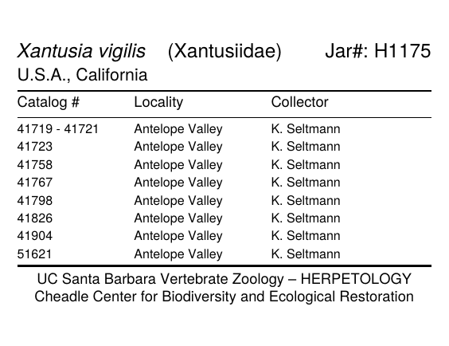
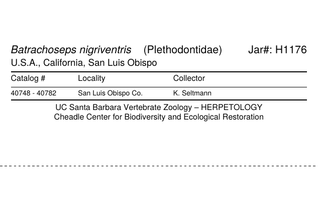

# Herpetology jar labels (UCSB)

Printer-ready jar labels for the fluid-preserved herpetology collection at the
UC Santa Barbara Cheadle Center for Biodiversity and Ecological Restoration (CCBER).

`make_jar_labels.py` reads the jar-inventory spreadsheet (one row per jar) and
writes a PDF with one label per page. It is built for continuous thermal roll
stock on a Datamax-O'Neil M-Class Mark II, printing left to right along the roll.



## What it does

- **Lays out the label** with the scientific name, family and jar number on the
  first line and the geography on the second, then a table of catalog numbers,
  localities and collectors with the two-line CCBER footer underneath.
- **Turns catalog numbers into rows.** Consecutive numbers print as a range
  (`40748 - 40782`) and gaps print as separate rows.
- **Handles jars with many specimens.** When the rows don't fit one column, the
  table continues in further columns to the right, so the label gets longer but
  never taller than the roll.
- **Sizes labels to a jar** when you ask it to (see [Jar sizes](#jar-sizes)).
  The type shrinks until the label fits.
- **Fills in families** by looking each genus up in the
  [GBIF backbone](https://www.gbif.org/developer/species). Results are cached in
  `family_cache.json`, so later runs work offline.
- **Writes a review file** (`*_review.csv`) listing every row that needed a
  judgement call. That includes unreadable or reversed catalog ranges, missing
  state or Jar #, genus spellings matched loosely in GBIF, and labels that don't
  fit their jar.

## Installation

Requires Python 3.9 or newer.

```bash
git clone https://github.com/cheadle-biodiversity/herpetology-labels-UCSB.git
cd herpetology-labels-UCSB
python -m venv .venv
source .venv/bin/activate        # Windows: .venv\Scripts\activate
pip install -r requirements.txt
```

## Quick start

```bash
# Try it on the sample workbook
python make_jar_labels.py examples/sample_jars.xlsx -o sample.pdf

# Every jar in your inventory
python make_jar_labels.py Herp_Label_Data.xlsx

# A few jars for a test print
python make_jar_labels.py Herp_Label_Data.xlsx --jar H1874 H1875 -o test.pdf

# Size every label for a 250 mL jar
python make_jar_labels.py Herp_Label_Data.xlsx --jar-size 250ml
```

Each run writes `<output>.pdf` and `<output>_review.csv`. The PDF defaults to
`jar_labels.pdf`.

## Spreadsheet format

The script uses every sheet whose header row contains **Catalog #s** and
**Scientific Name**. Header names are matched without regard to case.

| Column | Used for | Notes |
|---|---|---|
| `Jar #` | "Jar#: H1175" on the label | |
| `Catalog #s` | catalog rows | `41719-41729`, `41961-67`, and lists separated by commas or semicolons all work. If the cell is empty, `Side Catalog` and then `Top Catalog` are tried. |
| `Scientific Name` | first line, italic | Capitalisation is normalised (`Bufo Microscaphus` becomes *Bufo microscaphus*). |
| `State etc.` | second line | Common typos and abbreviations are fixed (`CA`, `CALFORNIA`). US states get the prefix "U.S.A.". |
| `County/Locality` | second line and Locality column | A county (`Santa Barbara Co.`) is also added to the second line. |
| `Jar Size` | label size | Optional. See [Jar sizes](#jar-sizes). |
| `Family` | family in parentheses | Optional. When absent, the family comes from GBIF. |
| `Collector` | Collector column | Optional. When absent, the Collector column is left off the label. |
| `Preservative` | printed bottom-right with `--preservative` | Optional. |

`examples/sample_jars.xlsx` shows the layout, including the optional
`Family` and `Collector` columns.

## Printing setup

- **Media:** 10 cm wide continuous roll. Every page is 10 cm tall (`--paper-width`)
  and as long as the label.
- **Orientation:** the PDF is landscape, with text running along the roll. If
  your printer driver is set to portrait, add `--rotate`.
- **Driver settings:** print at actual size (no "fit to page") with continuous
  media. The M-Class Mark II prints at 203 dpi, and the 0.75–1.5 pt rules and
  6 pt or larger type print cleanly at that resolution.
- **Trim line:** a label shorter than the roll width sits against the top edge,
  with a dashed trim line along its bottom edge. Use `--no-cut-line` to turn it off.
- **Fluid labels:** for labels that go into alcohol, SPNHC recommends
  polyester media with an alcohol-resistant ribbon. See
  [SPNHC herpetology curation](https://spnhc.org/herpetology-collection-curation/#Labels_and_systems_for_printing).

## Jar sizes



Give a jar size and the label is sized to that jar instead of to its content:

- **Height:** 60% of the jar's height, capped at the roll width.
- **Length:** `--wrap` × the jar's circumference (default 0.75, three-quarters
  of the way around).
- **Fitting:** type shrinks in steps down to `--min-scale` (default 60%) until
  the label fits. A label that still doesn't fit is printed longer and listed in
  the review file, with a warning if it would wrap past the jar's full
  circumference.

| Size | Thermo catalog # | Diameter × height | Label (height × length) |
|---|---|---|---|
| `125ml` (4 oz) | 121-0125 | 51 × 102 mm | 6.1 × 12.0 cm |
| `250ml` (8 oz) | 121-0250 | 62 × 127 mm | 7.6 × 14.6 cm |
| `500ml` (16 oz) | 121-0500 | 76 × 150 mm *(estimated)* | 9.0 × 17.9 cm |
| `950ml` (32 oz) | 121-1000 | 95 × 170 mm | 10.0 × 22.4 cm |
| `2000ml` (64 oz) | 221-2000 | 124 × 214 mm | 10.0 × 29.2 cm |
| `4000ml` (1 gal) | 121-4000 | 133 × 253 mm | 10.0 × 31.3 cm |

The dimensions are for Thermo Scientific wide-mouth, tall-profile glass jars
([product page](https://www.thermofisher.com/order/catalog/product/121-1000)).
The 500 mL dimensions aren't published there and are an estimate, so measure a
jar and correct them.

Ways to give a size, either as `--jar-size` or in the sheet's `Jar Size` column:

- **Size key:** `250ml`
- **Alias:** `8oz`, `quart`, `gallon`
- **Thermo catalog number:** `121-0250`. The 221- and 321- versions work too.
- **Size word:** `xsmall`, `small`, `medium`, `large`, `xlarge`. These map to
  125 mL, 250 mL, 500 mL, 950 mL and 2 L. **The mapping is a guess; check it
  against your shelves.**
- **Any jar by dimensions:** `70x150` (diameter × height in mm).

Misspellings such as `meduium` are matched to the closest size and flagged in
the review file. Rows with no size are sized to their content.

`python make_jar_labels.py --list-jar-sizes` prints the table. To add jars or
change the mappings, edit `JAR_SIZES` and `JAR_ALIASES` in the script.

## Options

| Option | Default | What it does |
|---|---|---|
| `-o, --output` | `jar_labels.pdf` | Output PDF; the review CSV is written next to it. |
| `--sheet NAME ...` | all matching sheets | Only these sheets. |
| `--jar H1874 ...` | all | Only these Jar #s. |
| `--limit N` | — | Stop after N labels. |
| `--jar-size SIZE` | from sheet | Size every label for one jar. |
| `--list-jar-sizes` | — | Print the jar table and exit. |
| `--wrap F` | 0.75 | How far around the jar the label wraps. |
| `--min-scale F` | 0.6 | Smallest type scale used to fit a jar. |
| `--paper-width CM` | 10 | Roll width, which is the page height. |
| `--length CM` | fit content | Fixed label length. |
| `--max-length CM` | 30 | Flag labels sized to content that are longer than this. |
| `--scale F` | 1.0 | Scale all type. |
| `--valign center\|top` | center | Vertical position of the content within the label. |
| `--min-run N` | 2 | How many consecutive numbers it takes to make a range. |
| `--no-ranges` | — | One catalog number per row. |
| `--max-expand N` | 300 | Ranges in the sheet spanning more numbers than this are printed as written and flagged. |
| `--footer LINE ...` | CCBER footer | Replace the footer lines. |
| `--font-regular`, `--font-italic` | Avenir or Helvetica | TrueType files to use for the text. |
| `--no-gbif` | — | Use `family_cache.json` only. |
| `--no-family` | — | Leave the family off. |
| `--preservative` | — | Print the preservative bottom-right. |
| `--rotate` | — | Rotate pages 90° for portrait drivers. |
| `--no-cut-line` | — | Omit the dashed trim line. |

## Fonts

The label design uses **Avenir**. ReportLab can only embed TrueType fonts
(`.ttf` or `.ttc`). On macOS the script finds `Avenir.ttc` automatically. Elsewhere,
point it at TrueType files:

```bash
python make_jar_labels.py data.xlsx --font-regular AvenirBook.ttf --font-italic AvenirBookOblique.ttf
```

Avenir LT Pro is usually supplied as `.otf` (CFF), which ReportLab can't embed.
Without a usable Avenir the script falls back to Helvetica, which prints well on
thermal printers.

## Family lookup

Families come from the GBIF species-match API, using the genus with the
hints kingdom Animalia and phylum Chordata.

- **Cache:** results are stored in `family_cache.json`. Commit this file so
  other users don't need network access.
- **Manual families:** a few genera GBIF can't resolve, such as homonyms in
  other groups (*Heterodon*, *Micrurus*), are set by hand in `FAMILY_OVERRIDES`
  in the script.
- **Loose matches:** genera matched loosely (e.g. `Batracoseps` to
  *Batrachoseps*) still get a family but are flagged in the review file, so
  the spelling can be fixed in the spreadsheet.
- **Your own families:** a `Family` column in the sheet always takes precedence.

## Repository contents

```
make_jar_labels.py        the label generator
family_cache.json         cached genus → family lookups from GBIF
requirements.txt
examples/
  sample_jars.xlsx        two-jar sample in the inventory format
  sample_labels.pdf       its labels, sized to content
  sample_labels_250ml.pdf the same jars with --jar-size 250ml
  label_preview*.png      images used in this README
```
