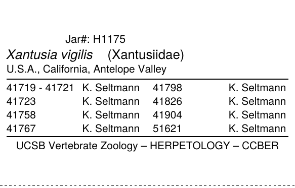
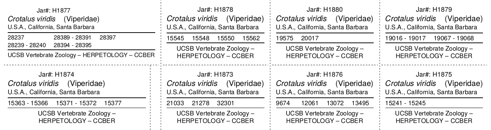

# Herpetology jar labels (UCSB)

Printer-ready jar labels for the fluid-preserved herpetology collection at the
UC Santa Barbara Cheadle Center for Biodiversity and Ecological Restoration (CCBER).

`make_jar_labels.py` reads the jar-inventory spreadsheet (one row per jar) and
writes printer-ready PDFs, one per label size. It is built for continuous
thermal roll stock (10 cm wide) on a Datamax-O'Neil M-Class Mark II, printing
left to right along the roll.

Labels are printed in **batches of one jar size**: give each jar's
circumference and height in the spreadsheet, and the script looks up the label
size for that jar in `jar_sizes.csv`.



## What it does

- **Sizes each label to its jar** from `jar_sizes.csv` (see [Jar sizes](#jar-sizes)),
  and writes one PDF per label size, so each batch prints as one job.
- **One label format for every jar**, between the two trial labels that read
  best: Jar H1033 at the small end and Jar H742 (130% of H1033) at the large
  end. Each label gets the largest type in that range that fits it.
- **Turns catalog numbers into rows.** Consecutive numbers print as a range
  (`40748 - 40782`), and the rows continue in further columns when one column
  is full.
- **QR code only when it's needed.** A label whose catalog numbers don't fit
  prints the count and range ("14 specimens: 7756 – 30595 / Full list: scan QR
  code") and a QR code holding the full list. Every other label has no QR code.
- **Saves roll** with `--strip`: labels end to end down the roll, two short
  labels side by side (two 5 cm labels share the 10 cm roll).
- **Fills in families** from the [GBIF backbone](https://www.gbif.org/developer/species),
  cached in `family_cache.json`, and **localities and collectors** from the
  Symbiota portal export (`--portal`).
- **Puts jar numbers into the portal:** `make_symbiota_upload.py` builds a CSV
  that adds each specimen's jar ("jarNumber: H1334") to its Dynamic Properties
  by Symbiota's skeletal upload, keeping anything already there. See [Jar numbers into the Symbiota portal](#jar-numbers-into-the-symbiota-portal).
- **Writes a review file** (`*_review.csv`) listing every label that needed a
  judgement call, each line marked **CHECK** (fix or confirm before printing)
  or **info** (routine). See [Review file](#review-file).

## Installation

Requires Python 3.9 or newer.

```bash
git clone https://github.com/cheadle-biodiversity/herpetology-labels-UCSB.git
cd herpetology-labels-UCSB
python -m venv .venv
source .venv/bin/activate        # Windows: .venv\Scripts\activate
pip install -r requirements.txt
```

## Quick start

```bash
# Try it on the sample batch (eight jars, all C 13 x H 8.5 cm)
python make_jar_labels.py examples/sample_batch.xlsx --strip -o batch.pdf

# A batch from your inventory: rows have Circumference (cm) and Height (cm)
python make_jar_labels.py Batch_13x8.5.xlsx --portal SymbOutput_DwC-A.zip --strip

# Label every jar in a sheet as one jar size
python make_jar_labels.py Herp_Label_Data.xlsx --jar H1874 H1875 --jar-size 13x8.5

# Only jars with no conflicts against the portal
python make_jar_labels.py Herp_Label_Data.xlsx --reconciliation Reconciliation.xlsx --exact-names
```

Each run writes `<output>.pdf` and `<output>_review.csv`. The PDF defaults to
`jar_labels.pdf`. If the sheet holds jars of more than one size, the PDFs are
named by label size: `jar_labels_5x12cm.pdf`, `jar_labels_8x13cm.pdf`, ….

### Review file

Every line in `<output>_review.csv` has a **level**. CHECK lines come first,
and the run ends by naming the jars that have them:

```
*** 2 label(s) need checking before printing (CHECK in the review file): H1327, H1341
```

| Level | Means | Examples |
|---|---|---|
| **CHECK** | The label may be wrong: fix the spreadsheet (or confirm) and re-run before printing those jars | a catalog number that is a different taxon in the portal ("others: 15060 Ambystoma californiense"); a number not in the portal; duplicate portal records; `Catalog_Verified` empty; a number found in the jar but not in `Catalog #s`; unreadable catalog numbers; missing name, state or Jar #; no jar size or a jar not in `jar_sizes.csv`; a label that doesn't fit its jar; skipped rows |
| **info** | The label is right; this records what the script did | name updated from the portal; numbers not found in the jar (left off); count-and-range or catalog-numbers-only labels; GBIF spelling matches |

The list of CHECK messages is `CHECK_PATTERNS` in the script.

## Spreadsheet format

The script uses every sheet whose header row contains **Catalog #s** and
**Scientific Name**. Header names are matched without regard to case.

| Column | Used for | Notes |
|---|---|---|
| `Jar #` | "Jar#: H1175" on the label | |
| `Catalog_Verified` | catalog rows | The catalog numbers found in the jar on inspection. When filled in, the label uses these; numbers in `Catalog #s` that weren't found are left off and listed in the review file. When empty, the label uses `Catalog #s` and is flagged "not verified yet". |
| `Catalog #s` | catalog rows | `41719-41729`, `41961-67`, and lists separated by commas or semicolons all work. If the cell is empty, `Side Catalog` and then `Top Catalog` are tried. |
| `Scientific Name` | first line, italic | Used only without `--portal`; capitalisation is normalised (`Bufo Microscaphus` becomes *Bufo microscaphus*). With `--portal` the portal's current name is printed instead (see below). |
| `State etc.` | second line | Common typos and abbreviations are fixed (`CA`, `CALFORNIA`). US states get the prefix "U.S.A.". |
| `County/Locality` | second line and Locality column | A county (`Santa Barbara Co.`) is also added to the second line. |
| `Jar_cir`, `Jar_height` | label size | The jar's outside circumference and height in cm, looked up in `jar_sizes.csv`. Any header starting with "cir"/"jar cir" and "height"/"jar height"/"ht" works (`Circumference (cm)`, `Jar Height`, …). See [Jar sizes](#jar-sizes). |
| `Label height (cm)`, `Label length (cm)` | label size | Optional: give the label size directly instead. |
| `Jar Size` | label size | Optional, older form: `13x8.5` (circumference × height, cm) or a class letter. |
| `Family` | family in parentheses | Optional. When absent, the family comes from GBIF. |
| `Collector` | Collector column | Optional. When absent, the Collector column is left off the label. |
| `Preservative` | printed bottom-right with `--preservative` | Optional. |

`examples/sample_jars.xlsx` shows the layout, including the optional
`Family` and `Collector` columns.

## Printing setup

Settings that printed the Trial 1 batch correctly (13 Nov 2026), with
`--strip`:

- **Printer:** cutter off; cut the strip by hand along the dashed lines.
  Media type: continuous, direct thermal.
- **Driver stock:** 4.10 in wide × **22.00 in** high (55.9 cm), continuous.
  This must match `--strip-length` (default 55.9 cm). The driver prints every
  page as one stock-length "label": with the old 4.10 × 6.00 in stock, long pages
  were chopped every 6 in, and text near each break was lost in the printer's
  margin.
- **Adobe print dialog:** Page Sizing → **Size → Actual size** (not Fit, Shrink
  or Poster), portrait.
- **One page per batch** (`--one-page`): the whole set prints as one strip,
  with no breaks between labels. The driver's stock height must equal that
  page's length, which changes with each batch; the run prints it in inches
  ("set the driver stock to 4.10 in wide x 67.79 in high").
- **Page lengths:** each run lists every page's length, and no page is longer
  than `--strip-length`. If you change the driver's stock height, pass the same
  length, e.g. `--strip-length 100` for 100 cm stock.
- **Test page:** before a big batch, check the print preview, then print one
  short page.
- **Resolution:** the M-Class Mark II prints at 203 dpi; the 0.75–1.5 pt rules
  and 9 pt or larger type print cleanly.
- **One label per page** (without `--strip`): each page is 10 cm tall and as
  long as the label; add `--rotate` if the driver is set to portrait.
- **Fluid labels:** for labels that go into alcohol, SPNHC recommends
  polyester media with an alcohol-resistant ribbon. See
  [SPNHC herpetology curation](https://spnhc.org/herpetology-collection-curation/#Labels_and_systems_for_printing).

## Jar sizes

`jar_sizes.csv` lists the measured jars and the label each one gets:

| Column | Meaning |
|---|---|
| `Circumference (cm)`, `Height (cm)` | the jar |
| `Paper_use_Height` | label height as a share of the 10 cm roll: `50%` = 5 cm, `full` = 10 cm |
| `Paper_use_length_cm` | label length along the roll, i.e. around the jar |
| `Orientation` | `Landscape` (text runs along the roll) |
| `Example H#` | a jar of that size, for reference |

For example, a C 13 × H 8.5 cm jar gets a 5 × 12 cm label and a C 23 × H 9 cm
jar an 8.5 × 18 cm label. `python make_jar_labels.py --list-jar-sizes` prints
the table. Edit the CSV to add jars or change a label; `--jar-table` points to
another copy.

**Looking a jar up:** a jar within 0.15 cm of a row in both circumference and
height uses that row. Otherwise the script uses the biggest label in the table
for a jar no bigger than this one, so the label still fits, and flags it in the
review file.

**Giving the size** (first match wins):

1. `--label-size 5x12`: the label size directly, height × length in cm, for every jar.
2. `--jar-size 13x8.5`: every jar labelled as that jar (circumference × height, cm).
3. The sheet's `Label height (cm)` and `Label length (cm)` columns.
4. The sheet's `Circumference (cm)` and `Height (cm)` columns.
5. The sheet's `Jar Size` column (`13x8.5`, a class letter A–N, or a Thermo size).

A jar with no size is sized to its content and flagged.

**Length is trimmed to the content**, never longer than the table's length, so
no roll is spent on blank space.

### Type and format

Every label uses the format of the trial labels H1033 and H742: Jar# centred
over the name, *Scientific name* (Family), the geography line, a rule, the
catalog numbers, a rule and the one-line footer "UCSB Vertebrate Zoology –
HERPETOLOGY – CCBER" (wrapped at a dash on narrow labels).

| | Jar# | Name | Geography, rows, footer |
|---|---|---|---|
| Smallest (H1033) | 11 pt | 13 pt | 10.5 pt |
| Largest (H742) | 14.3 pt | 16.9 pt | 13.7 pt |

Each label gets the largest type in that range that fits. When a label can't
fit everything at H1033 size, it falls back, in order, to: catalog numbers only
(locality and collector left off); the count and range with a QR code; the same
without the geography line and footer. Only labels too small even for that
(the 6.5 cm vials) go below H1033 size, down to 9 pt. All are flagged in the
review file.

Without `--portal`, the sheet's single County/Locality goes in the geography
line ("U.S.A., California, Antelope Valley") instead of being repeated on every
row.

### QR code

Only labels that can't list their catalog numbers get a QR code. Scanning it
shows plain text, one catalog number per line:

```
Jar H1820 UCSB Herpetology
Updated 2026-11-06
14 specimens:
UCSB-HERP 7756
UCSB-HERP 15121
...
```

Jars with more than 15 specimens list ranges (`UCSB-HERP 10201-10212`) to keep
the code small. "Updated" is the print date (`--qr-date`); the prefix is
`--qr-prefix`. Modules are 3 printer dots (0.375 mm); 2-dot codes and a
per-specimen CSV table were tried and did not scan reliably. With `--no-qr` the
fallback label reads "Full list: see catalog".

## Saving roll: long strips

```bash
python make_jar_labels.py Batch_13x8.5.xlsx --portal SymbOutput_DwC-A.zip --strip
```



With `--strip` the PDF is a set of long pages, like a continuous label sheet.
Each page is as wide as the roll and up to `--strip-length` long (default
55.9 cm, 22 in). The labels run end to end down the roll, turned so their
length follows the roll.

- **Pairing:** two labels whose heights add up to no more than the roll width
  print side by side on the same stretch of roll: in a batch of 5 cm labels
  (the 50% rows of `jar_sizes.csv`), every two labels share the roll. The
  script picks the pairs that save the most roll (a maximum-weight matching).
- **Cutting:** dashed lines mark every cut: between labels down the roll,
  between the two labels of a pair, and the trim beside a single label that's
  narrower than the roll.
- **Finding a label:** the review and specimen CSVs give each jar's strip and
  position ("strip 2, label 4 (left)").
- **Options:** `--no-pairing` (one label per row), `--gap` (space between
  labels, default 0.3 cm), `--flip` (turn labels the other way if they come out
  upside down).

The run prints how much roll it used and what one label per row would have
needed.

## Locality and collector from the portal

The label spreadsheet has no per-specimen locality or collector, so they come
from the Symbiota export:

```bash
python make_jar_labels.py Herp_Label_Data.xlsx --portal SymbOutput_2026-10-16_160706_DwC-A.zip
```

- **Locality, one county in the jar:** the main feature of each specimen's
  portal locality, e.g. "Chiricahua Mtns." from "Chiricahua Mtns., Cave Creek
  Cyn., Cave Creek Cyn. Rd., 2.0 mi. E Southwestern Research Station".
  Distances are dropped ("1.8 mi. E of Portal" → "E of Portal"). When the
  label fits it at full type size, the next part is added too
  ("Chiricahua Mtns., Cave Creek Cyn."). "Junction" prints as "jct." and
  "quadrant"/"quadrat" as "quad." (`LOCALITY_ABBREV` in the script lists the
  abbreviations; add more there).
- **Scientific name and family:** from the portal's genus and species fields,
  genus and species only, with no authorship ("Klauber 1902") and no
  subspecies. A species hybrid keeps both parents ("Thamnophis atratus x
  hammondii"). The family comes from the portal too. When this differs from the
  sheet's Scientific Name, the review file says so ("name from portal:
  Pituophis catenifer (sheet: Pituophis melanoleucus)"). When the specimens in
  a jar have different portal names, the label uses the name most of them
  have, and the review file lists the others.
- **Locality, several counties in the jar:** each row shows its county
  ("Cochise Co.", "Pima Co.").
- **Collector:** first initial and surname ("Samuel S. Sweet" → "S. Sweet");
  two collectors → "W. Jennings & D. Miles"; three or more → "et al.".
- **Header line:** country, state and county come from the portal when every
  specimen shares them.
- Consecutive catalog numbers fold into a range only when their locality and
  collector are the same.

Each run also writes `<output>_specimens.csv`, with every shortened locality
and collector beside the full portal text, so the shortening can be checked.
Catalog numbers missing from the portal are listed in the review file.

### Printing only conflict-free jars

`herp_reconcile.py` checks the label spreadsheet against the Symbiota portal.
Pass its workbook to print only jars that passed:

```bash
python make_jar_labels.py Herp_Label_Data.xlsx \
    --reconciliation Reconciliation.xlsx --exact-names
```

- `--reconciliation` keeps jars whose status is "All matched" (change with
  `--status`).
- `--exact-names` also drops jars whose name differs from the portal's
  (synonyms, older names, spelling).

## Jar numbers into the Symbiota portal

`make_symbiota_upload.py` records each specimen's jar in the portal's
**Dynamic Properties** field (Darwin Core `dynamicProperties`) as
`jarNumber: H1334`. Dynamic Properties is a Darwin Core field, so the jar
number is in every portal export, for anyone pulling specimens on site.

It reads the same spreadsheets you print labels from, plus a **current**
download of the portal (the Darwin Core export zip). Download it just before
running, so the script sees what is in the portal now:

```bash
python make_symbiota_upload.py batches/Trial_1_52_24.csv batches/Trial_2_52_24.csv \
    --portal SymbOutput_2026-11-20_DwC-A.zip -o batches/jar_upload.csv
```

### Keeping what's already in the portal

The script looks at each specimen's current Dynamic Properties in the download:

| Current value | What happens | File |
|---|---|---|
| empty | gets `jarNumber: H1334` | `jar_upload.csv`, for the Skeletal File Upload |
| already this jar | nothing to do | listed (info) in `jar_upload_review.csv` |
| a **different** jar | left out | CHECK in `jar_upload_review.csv` |
| other text, no jar | merged: existing text + `; jarNumber: H1334` (JSON stays JSON: `{"sex": "F", "jarNumber": "H1334"}`) | `jar_upload_merge.csv` |

So the main upload only ever fills empty fields, and nothing already in the
portal is replaced. The merge file holds the specimens that need their
existing text kept alongside the jar number (none in the 16 Oct 2026 export:
Dynamic Properties was empty on every record).

### What's left out

So a wrong jar never reaches the portal (all CHECK in the review file):

| Left out | Why |
|---|---|
| Jars with a missing or uncertain number ("H1339?", "H10??", "illegible") | the jar number itself isn't known |
| Jars with `Catalog_Verified` empty | not checked yet (`--include-unverified` uses `Catalog #s` instead, flagged) |
| A catalog number listed in two jars | it can only be in one |
| A number not in the portal | nothing to update |
| A number with two portal records | the upload would update both |
| A number that's a different taxon from the rest of its jar | probably a misread tag |
| Dynamic Properties already names a different jar | needs checking by hand |

Resolve the CHECK lines from the label run first. Jars in several sheets
(reprints) are written once.

### Uploading to the portal

Use Symbiota's **Skeletal File Upload**, matched on catalog number. It only
fills fields that are empty in the portal and never overwrites existing data.
(See [Symbiota Docs: Importing and
Uploading](https://docs.symbiota.org/Collection_Manager_Guide/Importing_Uploading/).)
Never use the Full Text File Upload for this: it overwrites every field of the
matched records, including fields not in the file.

1. **Back up first:** in the collection's Administration Control Panel,
   download a backup file.
2. **Test with a few rows:** copy the header and 2–3 rows of `jar_upload.csv`
   into a small test file and upload that first.
3. **Import/Update Specimen Records → Skeletal File Upload**, and choose the CSV.
4. **Map the fields:** `catalogNumber` → catalogNumber, `dynamicProperties` →
   dynamicProperties. Choose **match on Catalog Number**.
5. **Start Upload**, then read the **Pending Data Transfer Report**: records to
   be updated should equal the rows in the file, with **0 new records**. New
   records mean some catalog numbers didn't match; stop and check.
6. **Transfer Records to Central Specimen Table.** Symbiota warns this step
   can't be undone.
7. Open two or three specimens in the portal, and check that a fresh export
   shows `jarNumber: H…` in dynamicProperties.

**Merge file:** a skeletal upload can't change a field that already has text.
For each specimen in `jar_upload_merge.csv`, either paste the merged value
into Dynamic Properties in the record editor, or clear the field (e.g. with
the portal's batch-editing tool) and upload the merge file's `catalogNumber`
and `dynamicProperties` columns as a skeletal upload. Re-download the portal
data and re-run the script first if any time has passed.

**Changing a jar later:** the same applies: edit the record, or clear the field
and upload again.

`--format` changes the text (default `jarNumber: {jar}`); `--jar` limits the run
to some jars.

## Options

| Option | Default | What it does |
|---|---|---|
| `-o, --output` | `jar_labels.pdf` | Output PDF; the review CSV is written next to it. |
| `--sheet NAME ...` | all matching sheets | Only these sheets. |
| `--jar H1874 ...` | all | Only these Jar #s. |
| `--limit N` | — | Stop after N labels. |
| `--jar-size CxH` | from sheet | Label every jar as this jar (circumference × height, cm), e.g. `13x8.5`. |
| `--label-size HxL` | from sheet | Label size directly (height × length, cm), e.g. `5x12`. |
| `--list-jar-sizes` | — | Print the jar table and exit. |
| `--jar-table CSV` | `jar_sizes.csv` | Jar → label table to use. |
| `--min-pt PT` | 10.5 | Smallest specimen-row type (H1033 size); everything else scales with it. |
| `--compact-footer LINE ...` | one-line CCBER footer | Footer for compact labels. |
| `--portal DWCA` | — | Symbiota export; per-specimen Locality and Collector. |
| `--strip` | — | Long pages down the roll, short labels paired side by side. |
| `--strip-length CM` | 55.9 | Longest page in `--strip` mode; never exceeded (a batch splits into more pages, never mid-label). Set it to the longest page your printer and driver accept, e.g. `250` for one page per batch. The run lists each page's length. |
| `--one-page` | — | The whole batch on one continuous page (no page breaks except at the start and end). The run prints the page length, e.g. "set the driver stock to 4.10 in wide x 67.79 in high"; set the driver to that before printing. Up to 250 cm. |
| `--gap CM` | 0.3 | Space between labels down the roll in `--strip` mode. |
| `--no-pairing` | — | With `--strip`, one label per row. |
| `--flip` | — | With `--strip`, turn the labels the other way. |
| `--no-qr` | — | No QR code, even on count-and-range labels. |
| `--qr-dots 3\|4` | 3 | QR module size in printer dots. |
| `--qr-date YYYY-MM-DD` | today | "Updated" date in the QR code. |
| `--qr-prefix TEXT` | UCSB-HERP | Prefix for each catalog number in the QR code. |
| `--qr-collection NAME` | UCSB Herpetology | Name on the QR code's first line. |
| `--show-size` | — | Print the jar and label size small in the upper-right corner (test prints). |
| `--reconciliation XLSX` | — | Print only jars that passed `herp_reconcile.py`. |
| `--status S ...` | All matched | Jar statuses to print with `--reconciliation`. |
| `--exact-names` | — | Also skip jars whose name differs from the portal. |
| `--paper-width CM` | 10 | Roll width, which is the page height. |
| `--length CM` | fit content | Fixed label length. |
| `--max-length CM` | 30 | Longest label for a jar with no size (flagged if longer). |
| `--scale F` | 1.0 | Scale all type. |
| `--valign center\|top` | center | Vertical position of the content within the label. |
| `--min-run N` | 2 | How many consecutive numbers it takes to make a range. |
| `--no-ranges` | — | One catalog number per row. |
| `--max-expand N` | 300 | Ranges in the sheet spanning more numbers than this are printed as written and flagged. |
| `--footer LINE ...` | CCBER footer | Replace the footer lines. |
| `--font-regular`, `--font-italic` | Avenir or Helvetica | TrueType files to use for the text. |
| `--no-gbif` | — | Use `family_cache.json` only. |
| `--no-family` | — | Leave the family off. |
| `--preservative` | — | Print the preservative bottom-right. |
| `--rotate` | — | Rotate pages 90° for portrait drivers. |
| `--no-cut-line` | — | Omit the dashed trim line. |

## Fonts

The label design uses **Avenir**. ReportLab can only embed TrueType fonts
(`.ttf` or `.ttc`). On macOS the script finds `Avenir.ttc` automatically. Elsewhere,
point it at TrueType files:

```bash
python make_jar_labels.py data.xlsx --font-regular AvenirBook.ttf --font-italic AvenirBookOblique.ttf
```

Avenir LT Pro is usually supplied as `.otf` (CFF), which ReportLab can't embed.
Without a usable Avenir the script falls back to Helvetica, which prints well on
thermal printers.

## Family lookup

Families come from the GBIF species-match API, using the genus with the
hints kingdom Animalia and phylum Chordata.

- **Cache:** results are stored in `family_cache.json`. Commit this file so
  other users don't need network access.
- **Manual families:** a few genera GBIF can't resolve, such as homonyms in
  other groups (*Heterodon*, *Micrurus*), are set by hand in `FAMILY_OVERRIDES`
  in the script.
- **Loose matches:** genera matched loosely (e.g. `Batracoseps` to
  *Batrachoseps*) still get a family but are flagged in the review file, so
  the spelling can be fixed in the spreadsheet.
- **Your own families:** a `Family` column in the sheet always takes precedence.

## Repository contents

```
make_jar_labels.py        the label generator
make_symbiota_upload.py   jar numbers -> Symbiota Dynamic Properties (CSV for skeletal upload)
jar_sizes.csv             measured jars and the label size for each
family_cache.json         cached genus → family lookups from GBIF
requirements.txt
examples/
  sample_batch.xlsx       eight jars of one size (C 13 x H 8.5 cm)
  sample_batch_strip.pdf  their labels with --strip, paired across the roll
  sample_jars.xlsx        two jars with Family and Collector columns
  sample_labels.pdf       their labels
  *_preview.png           images used in this README
```
